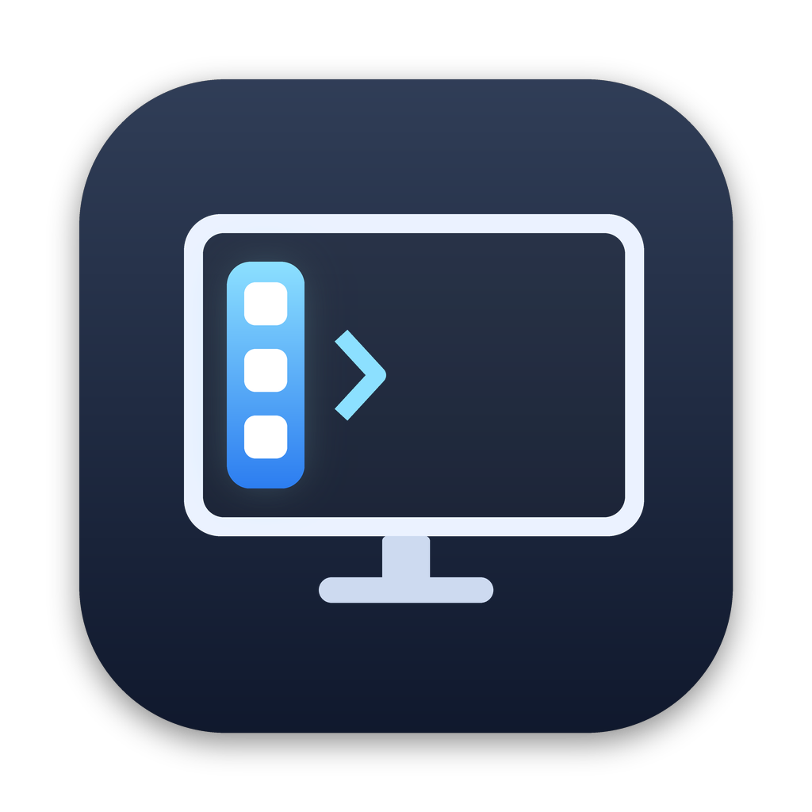

<p align="center">
  
</p>

<h1 align="center">EchoEdge</h1>

<p align="center">An extra, auto-hiding Dock for any display and any edge of your Mac, alongside Apple's Dock.</p>

<p align="center">
  <a href="https://github.com/echoappstudio/EchoEdge/releases/latest">Download the latest release</a> · macOS 26+ · Apple Silicon
</p>

<p align="center">
  <a href="https://github.com/echoappstudio/EchoEdge/releases/latest"></a>
  
  <a href="https://github.com/echoappstudio/EchoEdge/actions/workflows/macos-ci.yml"></a>
  <a href="LICENSE"></a>
</p>

## Features

- **Any display, any edge.** Put the launcher on the left, right or bottom edge of the display you choose, whichever edge Apple's Dock uses.
- **Pops out, tucks away.** It slides out when your pointer reaches that edge and hides again when you move away. Where another display touches the edge, pause for a moment, so crossing between displays doesn't open it.
- **Mirrors your Dock.** Finder and the apps pinned in your Dock, in the same order, then any other open apps after a divider. Running apps get a dot. Pin, unpin or reorder apps in Apple's Dock and EchoEdge follows.
- **Works like the Dock.** Click to open or switch to an app, right-click for its windows, Show in Finder, Hide and Quit, and drop files on an app to open them with it.
- **Keeps Apple's Dock where it is.** If both use the same edge, EchoEdge stops Apple's Dock from jumping onto EchoEdge's display.
- **Over full-screen apps too**, on every desktop (Space) of that display. Both can be turned off.
- **Its own app, out of the way.** No menu-bar icon. EchoEdge shows in Apple's Dock only while its Settings window is open.
- **Free and private.** No account, no subscription, no tracking.

## Install

1. Download `EchoEdge.zip` from the [latest release](https://github.com/echoappstudio/EchoEdge/releases/latest) and open it.
2. Drag **EchoEdge** into your **Applications** folder and open it. It's signed and notarized by Apple, so it opens normally.
3. Settings opens on first launch. Choose the **display** and **edge**, and allow **Accessibility** when macOS asks (System Settings → Privacy & Security → Accessibility → EchoEdge). The launcher works without it, but Accessibility adds the window list, click-to-minimize and keeping Apple's Dock in place.
4. Optional: turn on **Open EchoEdge at login** in Settings.

EchoEdge updates itself: it checks GitHub when it opens and every hour after, and installs new versions while the launcher is hidden.

## Shortcuts

| On the launcher | What it does |
|---|---|
| Click an app | Opens it, or switches to it and brings back a window |
| Click the app in front | Minimizes its window (can be turned off; needs Accessibility) |
| ⌘-click an app | Shows it in Finder |
| Right-click (or Control-click) an app | Its windows, Open, Show in Finder, Hide or Show, Quit |
| Drop files on an app | Opens them with that app |
| Right-click an empty spot | EchoEdge Settings…, Quit EchoEdge |
| Open EchoEdge again (Finder, Spotlight) | Opens Settings |

## How it works

1. EchoEdge reads Apple's Dock settings (the pinned apps and which edge it's on) and the list of open apps. Neither needs any permission.
2. It watches where the pointer is. When it reaches the chosen edge of the chosen display, the launcher slides out; when the pointer moves away, it slides back.
3. The launcher is a panel that never takes focus, so the app you're using stays in front until you click something.
4. With Accessibility allowed, EchoEdge also holds back pointer moves right at its edge from Apple's Dock (it never touches clicks or keys), so Apple's Dock can't move onto that display. It lists and minimizes windows the same way.
5. Displays are remembered by their own ID. Unplug the chosen display and the launcher waits for it to come back.

## Where your files are

| What | Where |
|---|---|
| Settings | `~/Library/Preferences/com.echoapps.echoedge.plist` |
| The app | `/Applications/EchoEdge.app` |

EchoEdge never changes Apple's Dock or its settings.

## Privacy

EchoEdge has no account, no analytics and no server. It goes online only to check this repository's releases for updates (you can turn that off in Settings). Accessibility is used only for the window list, minimizing, and keeping Apple's Dock away from EchoEdge's edge.

<details>
<summary><strong>Build and test</strong></summary>

You need macOS 26 and Xcode 26 (or its command-line tools).

```bash
git clone https://github.com/echoappstudio/EchoEdge.git
cd EchoEdge
swift test
bash Scripts/package-app.sh   # builds dist/EchoEdge.app, ad-hoc signed
open dist/EchoEdge.app
```

The logic for edges, timing, the Dock list and settings is in `Sources/EchoEdgeCore` with unit tests in `Tests/EchoEdgeTests`; the app is in `Sources/EchoEdgeApp`. GitHub Actions builds, tests, packages, launches and update-tests every change on macOS, and publishes releases from `main`.

</details>

## License

[MIT](LICENSE). © 2026 Echo App Studio. EchoEdge uses [Sparkle](https://sparkle-project.org) for updates (MIT; see `Resources/Acknowledgements.txt`).
